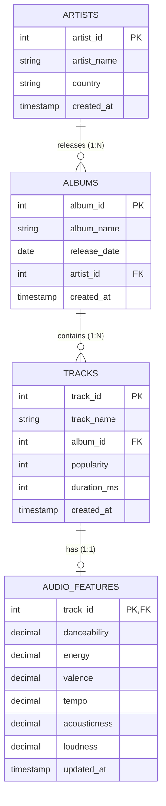

# Spotify Audio Features & Popularity Explorer 🎵
### College DBMS Capstone Project | Full-Stack Web Application

A full-stack music analytics and relational database exploration platform built with **Python (Flask)**, **MySQL**, **Chart.js**, and **HTML5/CSS3**. Inspired by Spotify's dark-mode user interface, this capstone project demonstrates relational database design, SQL DDL/DML, multi-table JOINs, aggregate functions, CRUD operations, and interactive data visualization.

---

## 📸 Key Features & Modules

1. **Module 1: Database Management (Full CRUD)**
   - Complete management for **Artists**, **Albums**, **Tracks**, and **Audio Features**.
   - Input validation, parameterized queries, and safe foreign key cascading deletions.
   - Filter, sort, and live search records.

2. **Module 2: SQL-Based Analytics Engine**
   - Implements and executes 8 real-time SQL analytical queries:
     1. **Top 10 Popular Tracks** (JOIN, `ORDER BY popularity DESC LIMIT 10`)
     2. **Aggregate Track Popularity Statistics** (`COUNT`, `AVG`, `MIN`, `MAX`)
     3. **Artist-Wise Average Popularity** (Multi-table JOIN, `GROUP BY`, `ORDER BY`)
     4. **Album-Wise Track Analysis** (`COUNT`, `AVG`, track yield and duration)
     5. **High-Popularity Tracks** (`WHERE popularity >= 70`)
     6. **Most Popular Artist Overall** (Aggregate ranking with `LIMIT 1`)
     7. **Audio Feature Fingerprint Comparison** (Multi-dimensional DSP audio metrics)
     8. **Danceability & Energy Analysis** (Composite Party Index calculation)
   - Live SQL syntax box displayed in the UI alongside query results and interactive charts.

3. **Module 3: Dashboard & Reporting**
   - Real-time KPI summary cards (Total Tracks, Total Artists, Total Albums, Average Popularity).
   - Overview Popularity Line Chart with green glow and smooth tension.
   - 4-metric Audio Features Doughnut Chart (Danceability, Energy, Valence, Acousticness).
   - Dynamic CSV Data Export (Tracks, Artists, Audio Features, or Full Joined Dump).
   - Printable / PDF analytical report view.

4. **Resilient Dual Database Support**
   - **Primary Engine**: MySQL 8.0+ via `mysql-connector-python`.
   - **Zero-Config Fallback**: Automatic local SQLite mirror with identical schema and dataset if MySQL is temporarily offline, ensuring the project can be demonstrated anytime without server startup issues.

---

## 🗄️ Relational Database Architecture

- **Database Name**: `spotify_explorer`
- **Schema Normalization**: 3rd Normal Form (3NF)



---

## 🚀 How to Run the Project in VS Code on Windows

### Step 1: Open the Project in VS Code
1. Launch **Visual Studio Code**.
2. Click **File > Open Folder...** and select the project directory:
   ```
   C:\Users\mrkha\Downloads\DBMS
   ```
3. Open a terminal inside VS Code: Press <kbd>Ctrl</kbd> + <kbd>`</kbd> (Backtick) or go to **Terminal > New Terminal**.

---

### Step 2: Install Python Dependencies
Run the following command in the VS Code terminal:
```bash
py -m pip install -r requirements.txt
```
*(Dependencies: `Flask`, `mysql-connector-python`, `pandas`, `python-dotenv`)*

---

### Step 3: Configure Database (MySQL / XAMPP / Workbench)

#### Option A: Running with Live MySQL (Recommended for College Viva)
1. Ensure your MySQL server is running (e.g., via **MySQL Workbench**, **XAMPP Control Panel > Start MySQL**, or Windows Services).
2. Open **MySQL Workbench** or MySQL CLI and run the script `database.sql`:
   ```sql
   source C:/Users/mrkha/Downloads/DBMS/database.sql;
   ```
   *(Or open `database.sql` in MySQL Workbench and click the lightning bolt ⚡ execute icon).*
3. Verify or update credentials in `.env`:
   ```env
   DB_HOST=localhost
   DB_PORT=3306
   DB_USER=root
   DB_PASSWORD=your_mysql_password
   DB_NAME=spotify_explorer
   ```

#### Option B: Zero-Config Mode (No MySQL setup needed!)
The application includes an automatic local mirror. If your MySQL server is not running, the application will automatically launch in resilient local mode with all 26 sample tracks, 8 artists, 12 albums, and audio features pre-loaded!

---

### Step 4: Run the Web Application
In your VS Code terminal, start the Flask server:
```bash
py app.py
```

You will see output similar to:
```
=======================================================
🎵 Spotify Audio Features & Popularity Explorer
📡 Server running at: http://127.0.0.1:5000
💾 Engine Status: Connected to MySQL (localhost:3306/spotify_explorer)
=======================================================
```

---

### Step 5: Open in Your Browser
Open your browser (Chrome, Edge, Brave) and visit:
👉 **[http://127.0.0.1:5000](http://127.0.0.1:5000)**

---

## 📂 Project Directory Structure

```text
DBMS/
│
├── app.py                  # Flask backend application with all routes
├── db.py                   # Relational DB connection, queries, and engine fallback
├── database.sql            # MySQL schema DDL and sample synthetic data
├── requirements.txt        # Python package dependencies
├── .env                    # Environment credentials
├── .env.example            # Example configuration template
├── README.md               # Project documentation & setup instructions
│
├── templates/              # HTML5 Jinja2 Templates
│   ├── base.html           # Master layout with Spotify sidebar & top header
│   ├── index.html          # Dashboard (KPIs, line chart, doughnut, table)
│   ├── artists.html        # Module 1: Artists CRUD management
│   ├── albums.html         # Module 1: Albums CRUD management
│   ├── tracks.html         # Module 1: Tracks CRUD management & sorting
│   ├── audio_features.html # Module 1: DSP Audio features matrix
│   ├── analysis.html       # Module 2: 8 SQL Analytical queries engine
│   ├── reports.html        # Module 3: Analytical reports & CSV exports
│   └── settings.html       # System health check & DB reset
│
└── static/
    ├── css/
    │   └── style.css       # Premium Spotify-inspired dark stylesheet
    └── js/
        ├── script.js       # Dynamic UI modals, search, and slider events
        └── charts.js       # Chart.js visualizations
```

---

## 🎓 DBMS Viva / Exam Q&A Reference

- **Why is `audio_features` a 1:1 table with `tracks`?**  
  *Audio features represent specialized digital signal processing (DSP) metrics. Normalizing them into a 1:1 table prevents the `tracks` entity from becoming bloated with technical metrics and follows 3NF design.*

- **How is referential integrity enforced?**  
  *Foreign keys with `ON DELETE CASCADE ON UPDATE CASCADE` ensure that when an artist is removed, their associated albums, tracks, and audio features are automatically cleaned up to prevent orphaned records.*

- **How are SQL injections prevented?**  
  *All database queries use parameterized SQL execution (`%s` placeholders with parameter tuples), ensuring user inputs are treated as literal values rather than executable code.*

- **What aggregate functions are demonstrated?**  
  *`COUNT()`, `AVG()`, `MIN()`, `MAX()`, `ROUND()`, along with relational `JOIN`s, `GROUP BY`, `HAVING`, and `ORDER BY`.*
